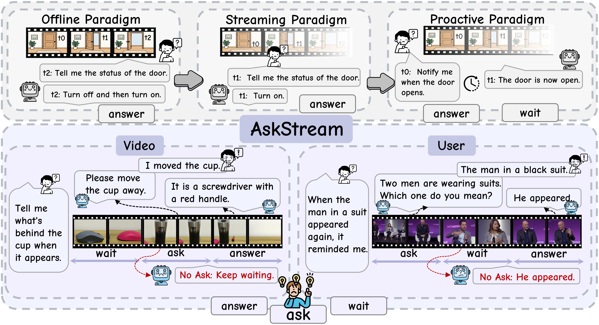
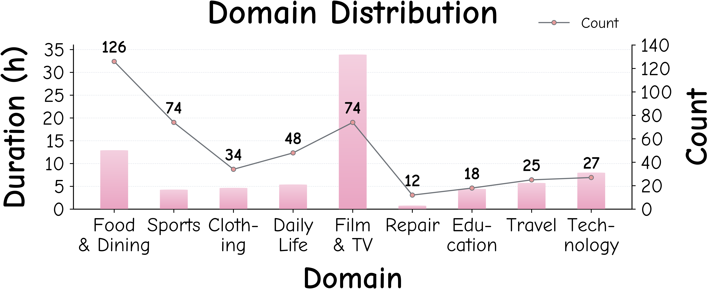
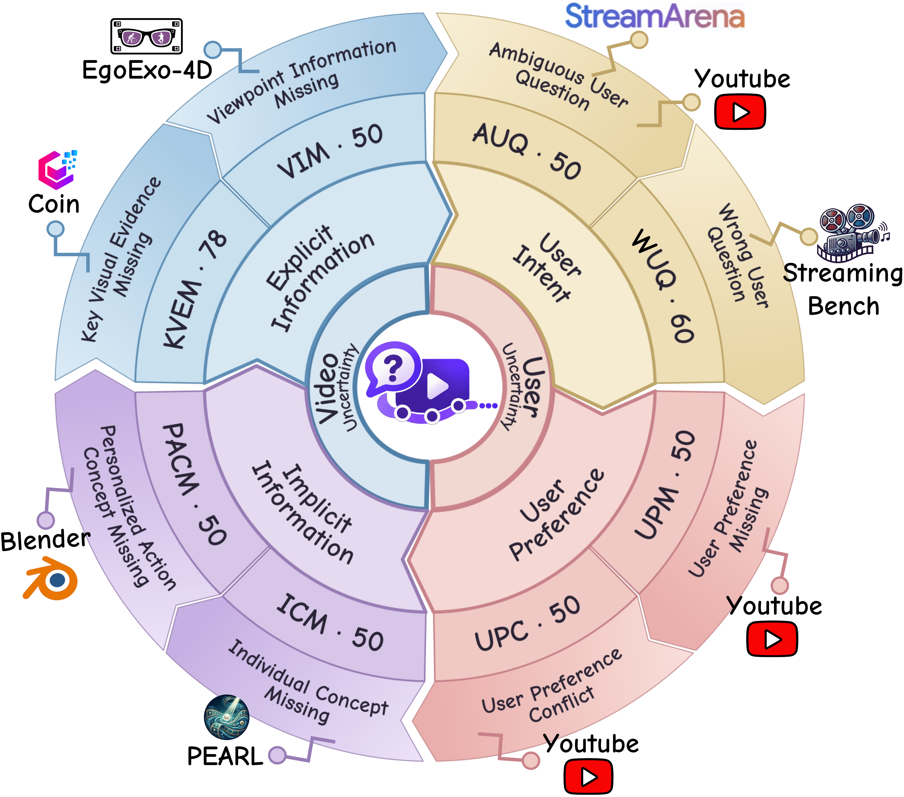
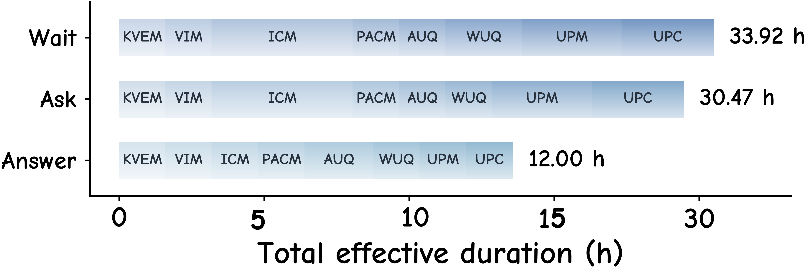

<h1 align="center">
  
  AskStream: When and What to Ask Proactively under Uncertainty in Streaming Video Understanding
</h1>

<p align="center">
  <strong>English</strong> &nbsp; | &nbsp;
  <a href="README_zh-CN.md">简体中文</a>
</p>

<p align="center">
  <em>From Passive Waiting to Proactive Asking</em>
</p>

<p align="center">
  <a href="YOUR_PAPER_URL"></a>
  <a href="https://huggingface.co/datasets/wanglucs/AskStream"></a>
  <a href="https://github.com/wanglu-cs/AskStream"></a>
  <a href="https://www.askstream.top"></a>
</p>

<p align="center">
  
</p>

---


## 🎞️ Overview

Existing proactive video understanding methods primarily focus on **when to answer**, assuming that the information required to answer a query will eventually become available. However, real-world streaming videos often involve uncertainty arising from missing visual evidence, ambiguous user queries, or incomplete personalized information. To address this challenge, **AskStream** introduces a new proactive interaction paradigm that extends conventional **WAIT** and **ANSWER** actions with **ASK**, enabling models to actively request missing information before answering.

### Key Evaluation Aspects

- 🎯 **When to Ask:** Can the model identify uncertainty and proactively ask at the appropriate moment?
- 💬 **What to Ask:** Can the model request the correct missing information from the video or user?
- ⏱️ **When to Answer:** Can the model determine the appropriate moment to provide an answer?
- ✅ **What to Answer:** Can the model provide an accurate answer based on the acquired information?


### Dataset Statistics

- 🎬 **438** videos across **9** diverse domains
- 📝 **1,401** questions covering **8** subtasks
- ⏱️ **2,714** manually annotated frame-level timestamps
- 🔄 An average of **3.2** interaction turns per video


### 🎬 Video Categories

AskStream covers nine diverse video domains, including Food & Dining, Sports, Clothing, Daily Life, Film & TV, Repair, Education, Travel, and Technology.



### 🔍 Task Taxonomy

AskStream consists of eight subtasks across two major uncertainty sources: **Video Uncertainty** and **User Uncertainty**, further divided into four task categories.



### ⏱️ Temporal Window Distribution

AskStream provides fine-grained temporal annotations for three interaction actions: **WAIT**, **ASK**, and **ANSWER**, with total effective durations of **33.92**, **30.47**, and **12.00** hours, respectively.



## 📁 Project Structure

```
AskStream/
├── assets/                         # Images used by the README
├── data/                           # AskStream dataset
├── eval/                           # Evaluation code
│   ├── run_streaming_parallel.py    # Parallel streaming evaluation entry point
│   ├── tasks.py                     # Evaluation task definitions
│   ├── paths.py                     # Project and data path helpers
│   └── streaming_harness/           # Core streaming evaluation framework
│       ├── __main__.py              # Command-line entry point
│       ├── config.py                # Runtime configuration
│       ├── cli_config.py            # CLI argument parsing
│       ├── dataset.py               # Dataset loading and iteration
│       ├── assets.py                # Evaluation asset management
│       ├── model_loader.py          # Model/backend loading
│       ├── video.py                 # Video loading and processing
│       ├── frames.py                # Frame sampling and frame utilities
│       ├── streaming.py             # Streaming execution logic
│       ├── memory.py                # Interaction history and memory state
│       ├── actions.py               # WAIT / ASK / ANSWER action definitions
│       ├── protocol.py              # Interaction protocol
│       ├── interfaces.py            # Backend interface definitions
│       ├── response_modes.py        # Model response formats
│       ├── prompts.py               # Model prompt templates
│       ├── generation.py            # Response generation helpers
│       ├── evaluator.py             # Evaluation orchestration
│       ├── judge.py                 # Judge-model evaluation
│       ├── judge_prompts.py         # Judge prompt templates
│       ├── metrics.py               # Metric computation
│       ├── validation.py            # Input and output validation
│       ├── schema.py                # Shared data schemas
│       ├── records.py               # Evaluation record structures
│       ├── provenance.py            # Result provenance tracking
│       ├── audit.py                 # Evaluation audit utilities
│       ├── health.py                # Backend health checks
│       ├── release.py               # Result release/export helpers
│       └── runner.py                # Main evaluation runner
├── model/                          # Model implementations and configurations
│   ├── offline_api/                 # OpenAI-compatible API backend
│   │   └── .privacy.json           # API endpoint and key configuration
│   ├── offline_vllm/                # Local vLLM backend
│   └── stream/                      # Streaming model backend
├── result/
│   └── main/                        # Evaluation outputs
├── web/                            # Browser-based annotation interfaces
│   ├── 01_video_filter/             # Candidate video filtering
│   ├── 02_video_annoation/          # Temporal and QA annotation
│   ├── 03_human_review/             # Final human review
│   └── README.md                    # Web interface documentation
├── README.md                       # English documentation
├── README_zh-CN.md                 # Chinese documentation
├── requirements.txt                # Python dependencies
└── LICENSE                         # Project license
```


## ⚙️ Evaluation Pipeline


### Environment Setup


#### 🐳 Docker (Recommended)

```bash
docker pull wanglucs/askstream:latest

docker run --gpus all -it --rm \
  -v "$PWD:/workspace" \
  -w /workspace \
  wanglucs/askstream:latest \
  bash
```


#### 🐍 Conda

```bash
conda create -n AskStream python=3.12 pip -y
conda activate AskStream

python -m pip install uv
python -m pip install -r requirements.txt
```

Install vLLM:

```bash
uv pip install --torch-backend auto vllm
```


#### API Configuration

Configure `base_url` and `api_key` in the `.privacy.json` file located in the directory of `model/offline_api`:

```json
{
  "base_url": "BASE_URL",
  "api_key": "API_KEY"
}
```


### Data Preparation

Install the Hugging Face CLI and download the complete AskStream dataset to the
`data` directory:

```bash
python -m pip install -U huggingface_hub

hf download wanglucs/AskStream \
  --repo-type dataset \
  --local-dir /mnt/userdata/AskStream/data
```


### Evaluation


#### API Backend

The API backend accepts any OpenAI-compatible Chat Completions endpoint. The
API key and default endpoint are read from `model/offline_api/.privacy.json`.

Run all tasks in multiple-choice mode:

```bash
python -m eval.run_streaming_parallel \
  --all \
  --mode multi-choice \
  --backend api \
  --model gpt-5.4 \
  --privacy-file model/offline_api/.privacy.json \
  --no-judge
```

Run all tasks in open-ended mode:

```bash
python -m eval.run_streaming_parallel \
  --all \
  --mode open-ended \
  --backend api \
  --model gpt-5.4 \
  --judge-model gemini-3.8-flash \
  --privacy-file model/offline_api/.privacy.json
```


#### vLLM Backend

Start an OpenAI-compatible vLLM server. The served model name must match the
value supplied to `--model` during evaluation.

```bash
MODEL_PATH_OR_HF_ID=/path/to/model

vllm serve "$MODEL_PATH_OR_HF_ID" \
  --served-model-name Qwen3-VL-4B-Instruct \
  --host 127.0.0.1 \
  --port 18003
```

Run all tasks in multiple-choice mode without an external judge:

```bash
python -m eval.run_streaming_parallel \
  --all \
  --mode multi-choice \
  --backend vllm \
  --model Qwen3-VL-4B-Instruct \
  --base-url http://127.0.0.1:18003/v1 \
  --no-judge
```

Run all tasks in open-ended mode. Open-ended ASK/ANSWER evaluation requires a
judge endpoint; configure its key and default URL in the privacy file.

```bash
python -m eval.run_streaming_parallel \
  --all \
  --mode open-ended \
  --backend vllm \
  --model Qwen3-VL-4B-Instruct \
  --base-url http://127.0.0.1:18003/v1 \
  --judge-model gemini-3.8-flash \
  --privacy-file model/offline_api/.privacy.json
```


#### Native Streaming Backend

A local streaming adapter must be placed under `model/stream/` and inherit
`StreamingModelBackend` from `eval.streaming_harness.interfaces`. 

```python
open_video(*, video_id, metadata)
push_observation(observation)
decide(request) -> ModelCallResult
reset_context(*, video_id, metadata)
abort_video(*, video_id, metadata=None)
close_video(*, video_id)
```

The adapter module must also expose a factory with the signature
`factory(config, *, api_key)` that returns the `StreamingModelBackend`
instance. Pass it as `model.stream.<module>:<factory>`. The examples below use
`model.stream.my_model:create_backend`; replace it with your adapter entry
point and model name.

Run all tasks in multiple-choice mode with a local adapter:

```bash
python -m eval.run_streaming_parallel \
  --all \
  --mode multi-choice \
  --backend streaming \
  --model my-streaming-model \
  --model-adapter model.stream.my_model:create_backend \
  --max-parallel 1 \
  --no-judge
```

Run all tasks in open-ended mode:

```bash
python -m eval.run_streaming_parallel \
  --all \
  --mode open-ended \
  --backend streaming \
  --model my-streaming-model \
  --model-adapter model.stream.my_model:create_backend \
  --max-parallel 1 \
  --judge-model gemini-3.8-flash \
  --privacy-file model/offline_api/.privacy.json
```

Evaluation artifacts and aggregate metrics are written automatically under
`result/main/`. Use `--video-id VIDEO_ID` to evaluate a specific video, or run
`python -m eval.run_streaming_parallel --help` for all available options.

---

## 🌐 Web Annotation Interfaces

The `web/` directory contains the three browser-based interfaces used by the  
AskStream annotation workflow. See `web/README.md` for interface-specific details.

## 📚 Citation

```

```
